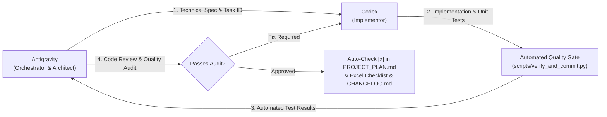

# OvaLens Master Project Plan & Execution Backlog

> **OvaLens: A YOLOv8-Based Deep Learning System for Automated Near-Real-Time Candling and Sorting of Itik Pinas Duck Eggs**  
> **Academic Institution**: College of Computer Studies, Foundation University, Dumaguete City  
> **Methodology Framework**: Design Science Research Methodology (DSRM; Peffers et al., 2007) + Agile Development Cycle (Beck et al., 2001)  
> **Engineering Roles**:  
> * **Antigravity**: Orchestrator, Lead Architect, System Design, Verification Gatekeeper, Code Review & Git Manager  
> * **Codex**: Implementor, Dedicated Feature Developer, Component Builder  

---

## 🏛️ 1. Team Workflow & Division of Responsibilities



| Responsibility | Antigravity (Orchestrator) | Codex (Implementor) |
| :--- | :---: | :---: |
| **System Architecture & Schematics** | Lead Owner | Reviewer / Consumer |
| **Task Breakdown & Phase Tracking** | Lead Owner | Inherits Workflow |
| **Technical Feature Implementation** | Reviewer & Verifier | Lead Owner |
| **Automated Test Execution** | Gatekeeper | Test Writer |
| **Security & Architecture Audit** | Lead Auditor | Fix Provider |
| **Git Commits & CHANGELOG.md** | Automated Operator | Trigger via `--task` |

---

## 🔁 2. Global Agent Protocol for Automated Feature Completion

Whenever **Codex** or any agent implements a feature, endpoint, or module, they MUST execute the automated quality gate specifying the task ID:

```bash
python scripts/verify_and_commit.py --task <TASK_ID> -m "<type>(<scope>): <subject>"
```

### What This Command Automatically Executes:
1. **Runs Test Suite**: Runs Backend API pytest (13 tests) + Edge CV pipeline pytest (8 tests) + Dashboard build.
2. **Updates Checklist**: Automatically finds `- [ ] **<TASK_ID>**` in this `PROJECT_PLAN.md` and marks it `- [x]`.
3. **Updates Excel Workbook**: Updates [`docs/OvaLens_Capstone_Feature_Checklist.xlsx`](file:///d:/Ryle_Gabotero/side_projects/Capstone/docs/OvaLens_Capstone_Feature_Checklist.xlsx) marking the row status as `Done`.
4. **Updates CHANGELOG**: Appends the feature under `[Unreleased]` in [`CHANGELOG.md`](file:///d:/Ryle_Gabotero/side_projects/Capstone/CHANGELOG.md).
5. **Git Commit**: Stages all changes and creates a standardized Conventional Commit.

---

## 📋 3. Exhaustive Subsystem Feature & Endpoint Checklist

### Phase 1: Planning & Requirements (DSRM: Problem ID & Objectives)
- [x] **TASK-DOC-01**: Authentic Capstone Manuscript Integration (`docs/manuscript/` Chapters 1–6, Title Page, Approval Sheet, 15 APA 7 references)
- [x] **TASK-DOC-02**: Import & Catalog Academic Diagrams (IPO Matrix, DSRM Methodology, System Flowchart, Use Cases in `.drawio` and `.html`)
- [x] **TASK-DOC-03**: Two-Tier Agent Workflow & Automated Quality Gate (`scripts/verify_and_commit.py` + `PROJECT_PLAN.md` + `CHANGELOG.md`)

---

### Phase 2: Data Collection & Preparation (Dataset Pipeline)
- [ ] **TASK-AI-DS-01**: Dataset 70/15/15 Stratification Pipeline (Split 3,000+ candling images into 70% Train, 15% Val, 15% Test across IP-Itim, IP-Khaki, IP-Kayumanggi and Day 10, 18, 25)
- [ ] **TASK-AI-DS-02**: Whole-Egg YOLO Bounding Box Validator (Verify darknet `[class_id, x, y, w, h]` enclosing the entire egg)
- [ ] **TASK-AI-DS-03**: Candling Transillumination Augmentations (HSV luminance jitter `V +/-20%` and `+/-15 deg` rotation pipeline)
- [ ] **TASK-AI-DS-04**: Dataset Distribution Summary Exporter (Generate automated Markdown and LaTeX tables for Chapter 3 & 4 manuscript)

---

### Phase 3: YOLOv8 Model Development & Edge Optimization
- [ ] **TASK-AI-TRN-01**: Ultralytics YOLOv8 Training Pipeline (Implement training pipeline with CIoU + BCE + DFL loss functions)
- [x] **TASK-AI-OPT-01**: ONNX FP16 Slim Export & Half-Precision Graph (`export_onnx.py` half-precision graph exporter)
- [x] **TASK-AI-OPT-02**: Production Weights Verified (`edge/models/weights/best.onnx` ready for runtime execution)
- [x] **TASK-AI-LAT-01**: Edge Inference Latency Benchmark (Enforce `<= 200 ms` SLA constraint on target hardware)
- [ ] **TASK-AI-EVL-01**: Breed Subgroup Metric Evaluator (Compute Precision, Recall, F1, mAP for IP-Itim vs IP-Khaki vs IP-Kayumanggi)
- [ ] **TASK-AI-EVL-02**: Day 10 Breed/Batch Subgroup Metric Evaluator (Compute Precision, Recall, F1, and mAP across Day 10 cohorts)
- [ ] **TASK-AI-EVL-03**: 2-Class Confusion Matrix & PR Curve Generator (Generate the Fertile/Infertile evaluation artifacts for Chapter 4)

---

### Phase 4A: Firmware & Microcontroller (`firmware/`)
- [x] **TASK-FW-INT-01**: Optical Sensor Hardware Interrupt (ESP32 GPIO 14 optical beam-break edge detection interrupt)
- [x] **TASK-FW-INT-02**: 600ms Hardware Optical Debounce Lockout (Non-blocking timer lockout preventing false double-triggers)
- [x] **TASK-FW-LED-01**: Candling Strobe LED Driver Relay (GPIO 19 strobe trigger synchronized with camera exposure)
- [x] **TASK-FW-SER-01**: Non-Blocking Serial UART Command Parser (Buffer incoming 115200 baud UART bytes without `delay()` calls)
- [x] **TASK-FW-SER-02**: Serial ACK / NACK Status Protocol (Transmit acknowledgement packets upon command execution to edge driver)
- [x] **TASK-FW-STP-01**: Stepper Pocket-Conveyor Transport Routine (Indexed step timing to advance pocket conveyor one cradle at a time: `CMD:MOTOR:START/STOP/STEP`)
- [x] **TASK-FW-SRV-01**: Servo Gate 1 - Fertile Release (Actuate servo diverter for Fertile eggs into cushioned incubation tray)
- [ ] **TASK-FW-SRV-02**: Servo Gate 2 - Infertile / Penoy Salvage (Actuate servo diverter for Day 10 Penoy salvage sale @ ₱14.00)
- [x] **TASK-FW-KIN-01**: Kinematic Actuation Delay Timer ($\Delta t = D / v = 25\text{ cm} / 12.5\text{ cm/s} = 2,000\text{ ms}$ delay before servo firing)

---

### Phase 4B: Edge CV & Desktop Controller (`edge/`)
- [x] **TASK-EDGE-CAM-01**: Multi-Threaded Circular Frame Grabber (Thread 1: OpenCV DirectShow/V4L2 continuous circular buffer drain)
- [x] **TASK-EDGE-CAM-02**: Camera Disconnect Recovery & Mock Mode (Auto-reconnect USB camera and generate mock frames for offline dev)
- [x] **TASK-EDGE-AI-01**: ONNX Runtime FP16 Inference Engine (Thread 2: ONNX Runtime execution provider running quantized YOLOv8)
- [x] **TASK-EDGE-AI-02**: Geometric Aspect-Ratio & Centering Gate (Enforce $0.65 \le \text{AR} \le 1.45$ to prevent classifying non-egg objects)
- [x] **TASK-EDGE-AI-03**: Model Cache Warmup Routine (Execute 3 dummy passes on startup to eliminate first-frame latency spikes)
- [x] **TASK-EDGE-HEU-01**: HSV Candling Luminance Analyzer (Analyze internal light transmission across yolk/albumin regions)
- [x] **TASK-EDGE-HEU-02**: Vascular Vein & Blood Ring Heuristics (Auxiliary edge detector verifying spider blood veins vs necrotic ring)
- [x] **TASK-EDGE-DB-01**: Local SQLite WAL Mode Store (Thread 4: Local scan persistence with `PRAGMA journal_mode = WAL;`)
- [x] **TASK-EDGE-DB-02**: Unsynced Scan FIFO Queue Manager (Track unsynced scans and handle exponential backoff retry)
- [x] **TASK-EDGE-SYN-01**: Background REST HTTP Sync Worker (Non-blocking background HTTP client transmitting batches of 50 scans)
- [x] **TASK-EDGE-SYN-02**: Local CSV Session Exporter (Emergency offline CSV exporter saving session records to local USB drive)
- [x] **TASK-EDGE-SER-01**: PySerial ESP32 UART Driver (Thread 3: Non-blocking serial worker communicating at 115200 baud)
- [x] **TASK-EDGE-SER-02**: Serial Mock Driver for Hardware-Free Dev (Simulate ESP32 optical triggers and servo responses in unit tests)
- [x] **TASK-EDGE-TRK-01**: Cradle Tracking FIFO Queue (Maintain cradle queue mapping `cradle_id` from image station to sorting gate)
- [x] **TASK-EDGE-TRK-02**: Conveyor Index Resynchronization Handler (Pause conveyor and alert operator if physical cradle index drifts)
- [x] **TASK-EDGE-REV-01**: Manual Review Fallback State Machine (Trigger manual review flag when confidence $< 0.75$ or egg uncentered)
- [x] **TASK-EDGE-UI-01**: CustomTkinter 60 FPS Operator Desktop UI (Main Thread: CustomTkinter operator GUI with Foundation University theme)
- [x] **TASK-EDGE-UI-02**: Live Candling Video Viewport (Smooth video rendering canvas with overlay bounding box and class tag)
- [x] **TASK-EDGE-UI-03**: Real-Time Session Statistics Counters (Live counters for Fertile, Infertile, and Manual Review)
- [x] **TASK-EDGE-UI-04**: Interactive Manual Override Dialog Modal (Modal popup enabling operator to inspect flagged egg and confirm class)
- [x] **TASK-EDGE-UI-05**: Conveyor Pause & Emergency Stop Controls (Instant physical rig pause and serial E-STOP command dispatch)

---

### Phase 4C: Central Backend REST API (`backend/`)
#### Authentication & User Management
- [x] **TASK-BE-AUTH-01**: `POST /api/v1/auth/login` (JWT authentication endpoint with bcrypt password verification and role extraction)
- [x] **TASK-BE-AUTH-02**: `GET /api/v1/auth/me` (Retrieve current authenticated user profile, permissions, and active status)
- [x] **TASK-BE-AUTH-03**: `POST /api/v1/auth/register` (Account registration endpoint with default Candling Worker role)
- [x] **TASK-BE-USR-01**: `GET /api/v1/users` (List all system users with role filters: Worker, Supervisor, Admin)
- [x] **TASK-BE-USR-02**: `POST /api/v1/users` (Admin user creation endpoint with RBAC role assignment)
- [x] **TASK-BE-USR-03**: `PATCH /api/v1/users/{id}/status` (Toggle user active/deactivated state to revoke credentials)
- [x] **TASK-BE-USR-04**: `PATCH /api/v1/users/me/profile` (Allow authenticated user to update display name and email)
- [x] **TASK-BE-USR-05**: `PATCH /api/v1/users/me/password` (Secure password change with old password verification)

#### Incubation Batches Lifecycle
- [x] **TASK-BE-BAT-01**: `GET /api/v1/batches` (List incubation batches with status and genetic group filters)
- [x] **TASK-BE-BAT-02**: `GET /api/v1/batches/active` (Retrieve currently active incubator batches needing candling inspection)
- [x] **TASK-BE-BAT-03**: `POST /api/v1/batches` (Create new incubation batch specifying breed: Itim/Khaki/Kayumanggi and egg count)
- [x] **TASK-BE-BAT-04**: `GET /api/v1/batches/{id}` (Get detailed batch record with tray matrix slots and current milestone)
- [x] **TASK-BE-BAT-05**: `GET /api/v1/batches/{id}/analytics` (Incubation analytics: fertility rate, mortality curve, penoy salvage total)
- [x] **TASK-BE-BAT-06**: `GET /api/v1/batches/{id}/forecast` (Hatch yield forecast based on the Day 10 fertility rate)
- [x] **TASK-BE-BAT-07**: `PUT /api/v1/batches/{id}` (Update batch metadata, notes, and incubator chamber ID)
- [x] **TASK-BE-BAT-08**: `POST /api/v1/batches/{id}/advance-stage` (Advance batch lifecycle: Setting -> Day 10 -> Hatched -> Completed)
- [x] **TASK-BE-BAT-09**: `POST /api/v1/batches/{id}/finalize-hatch` (Close batch lifecycle and record final hatchling count on Day 28)
- [x] **TASK-BE-BAT-10**: `GET /api/v1/batches/{id}/summary` (Comprehensive batch summary DTO for compliance and audit archiving)
- [x] **TASK-BE-BAT-11**: `DELETE /api/v1/batches/{id}` (Soft-delete or purge batch; Admin only protection)
- [x] **TASK-BE-BAT-12**: `POST /api/v1/batches/check-milestones` (Automated background cron to flag batches reaching Day 10, 18, 25)

#### Candling Sessions & Scan Ingestion
- [x] **TASK-BE-SES-01**: `GET /api/v1/sessions` (List all active and completed edge candling sorting sessions)
- [x] **TASK-BE-SES-02**: `POST /api/v1/sessions` (Start new candling session linked to batch and edge sorter device ID)
- [x] **TASK-BE-SES-03**: `GET /api/v1/sessions/{id}` (Get Day 10 session progress: total, fertile, and infertile counts)
- [x] **TASK-BE-SES-04**: `PUT /api/v1/sessions/{id}/end` (Conclude candling session and trigger batch analytics recalculation)
- [x] **TASK-BE-SCN-01**: `POST /api/v1/scans/sync` (Idempotent batch scan sync with `ON CONFLICT (scan_id) DO NOTHING`)
- [x] **TASK-BE-SCN-02**: `POST /api/v1/scans/upload-image` (Upload high-res candling frame image associated with scan ID)
- [x] **TASK-BE-SCN-03**: `GET /api/v1/scans` (Query historical scans with `batch_id`, stage, class, date filters)
- [x] **TASK-BE-SCN-04**: `GET /api/v1/scans/{id}` (Retrieve single scan record with confidence, bounding box, image URI)
- [x] **TASK-BE-SCN-05**: `PATCH /api/v1/scans/{id}/override` (Human-in-the-loop classification override with audit trail logging)

#### Analytics, Economic Reports & Administration
- [x] **TASK-BE-ANL-01**: `GET /api/v1/analytics/overview` (Aggregated hatchery statistics: total eggs, fertility rate, cull rate)
- [x] **TASK-BE-ANL-02**: `GET /api/v1/analytics/breed-comparison` (Disaggregated analytics comparing IP-Itim vs IP-Khaki vs IP-Kayumanggi)
- [x] **TASK-BE-ANL-03**: `GET /api/v1/analytics/mortality-trends` (Longitudinal mortality tracking across batches and candling stages)
- [x] **TASK-BE-ANL-04**: `GET /api/v1/analytics/mortality-progression` (Day 10 cull analysis by breed)
- [x] **TASK-BE-ANL-05**: `GET /api/v1/analytics/economic-yield` (Day 10 Penoy salvage revenue: `Count * ₱14.00` & thermal energy savings)
- [x] **TASK-BE-REP-01**: `GET /api/v1/reports/batch/{id}/csv` (Export CSV spreadsheet containing detailed scan log for batch)
- [x] **TASK-BE-REP-02**: `GET /api/v1/reports/batch/{id}/pdf` (Generate official Foundation University formatted PDF compliance report)
- [x] **TASK-BE-DEV-01**: `GET /api/v1/devices` (List registered edge sorter hardware rigs with online/offline status)
- [x] **TASK-BE-DEV-02**: `POST /api/v1/devices/register` (Register new ESP32 / Raspberry Pi edge node with MAC & station ID)
- [x] **TASK-BE-DEV-03**: `POST /api/v1/devices/{id}/heartbeat` (Edge node heartbeat ping transmitting status, temperature, and FPS)
- [x] **TASK-BE-SET-01**: `GET /api/v1/settings` (Fetch system settings: penoy price ₱14, confidence threshold, sync interval)
- [x] **TASK-BE-SET-02**: `PUT /api/v1/settings` (Update system settings with admin validation)
- [x] **TASK-BE-SET-03**: `POST /api/v1/settings/backups/create` (Trigger compressed JSON.GZ snapshot of PostgreSQL database)
- [x] **TASK-BE-SET-04**: `GET /api/v1/settings/backups` (List available database backup archive files)
- [x] **TASK-BE-SET-05**: `GET /api/v1/settings/backups/{file}/download` (Secure endpoint to download encrypted database backup)
- [x] **TASK-BE-AUD-01**: `GET /api/v1/audit_logs` (Query immutable system audit trail with user and timestamp filters)

---

### Phase 4D: Web Admin Dashboard (`dashboard/`)
#### Pages & Workspaces
- [x] **TASK-DASH-PG-01**: `LoginPage.tsx` (Login view with Foundation University maroon branding and token persistence)
- [x] **TASK-DASH-PG-02**: `OverviewPage.tsx` (Real-time KPI summary cards of active batches, fertility %, and sorting volume)
- [x] **TASK-DASH-PG-03**: `BatchesPage.tsx` (Table of all batches, Day 10 stage advancement, and hatch closure)
- [x] **TASK-DASH-PG-04**: `ScanExplorerPage.tsx` (Filterable grid of historical scan captures with image lightbox inspection)
- [x] **TASK-DASH-PG-05**: `AnalyticsPage.tsx` (Recharts visualizer for mortality curves, breed comparisons, Penoy revenue)
- [x] **TASK-DASH-PG-06**: `RecordsPage.tsx` (Consolidated into Batches and Analytics pages)
- [x] **TASK-DASH-PG-07**: `DevicesPage.tsx` (Live cards showing connected Raspberry Pi and ESP32 sorter rigs)
- [x] **TASK-DASH-PG-08**: `ModelsPage.tsx` (Pruned; models managed offline with ONNX FP16 edge deployment)
- [x] **TASK-DASH-PG-09**: `UsersPage.tsx` (Admin table for managing operator, supervisor, and administrator accounts)
- [x] **TASK-DASH-PG-10**: `AuditLogsPage.tsx` (Pruned redundant security audit trail to streamline hatchery operations)
- [x] **TASK-DASH-PG-11**: `SettingsPage.tsx` (Configure Penoy price ₱14, confidence thresholds, and DB backup downloads)

#### Reusable UI Widgets & System Tokens
- [x] **TASK-DASH-CP-01**: Linear Conveyor Telemetry (Real sorting throughput pace replacing synthetic 42-slot tray simulation)
- [x] **TASK-DASH-CP-02**: Day-10 Penoy Economic Recovery Model (Backend-driven economic recovery model replacing manual slider simulator)
- [x] **TASK-DASH-CP-03**: Breed Filter Dropdown (Dropdown to isolate metrics by `IP-Itim`, `IP-Khaki`, `IP-Kayumanggi`)
- [x] **TASK-DASH-CP-04**: Day 10 Candling Filter Toggle
- [x] **TASK-DASH-CP-05**: Dark / Light Mode Theme System (TailwindCSS theme switcher with FU Maroon `#800000` accents)

---

### Phase 5: System Integration & Demonstration (Demonstration)
- [ ] **TASK-INT-01**: End-to-End Sorting Pilot Simulation (Simulate 50-egg cycle: load -> index -> capture -> predict -> divert -> sync)
- [ ] **TASK-INT-02**: Offline Network Replay Resilience Test (Cut network; confirm 100% sorting at edge; reconnect and verify bulk replay)
- [ ] **TASK-INT-03**: Cradle Position Jam Recovery Test (Simulate mechanical index slip; verify conveyor pauses and resyncs)

---

### Phase 6: Empirical Evaluation & Benchmarking (Evaluation)
- [ ] **TASK-EVL-01**: Physical Sorting Accuracy Benchmark (Run $\ge 100$ physical duck egg trials to measure sorting accuracy rate)
- [ ] **TASK-EVL-02**: System Throughput & Cycle Time Profiling (Measure end-to-end cycle time per egg and throughput in eggs/min)

---

### Phase 7: Deployment & Defense Communication (Communication)
- [ ] **TASK-DEF-01**: Manuscript Chapter 4 Results & Discussion (Draft Chapter 4 using empirical metrics, confusion matrices, latency charts)
- [ ] **TASK-DEF-02**: Manuscript Chapter 5 Conclusions & Recommendations (Summarize findings, answer research questions 1–4)
- [x] **TASK-DEF-03**: 1-Click Docker Production Packaging (Verify `docker-compose up` for PostgreSQL, FastAPI, React dashboard)

---

## 🔮 4. Backlog for Potential New Features & Expansions

These features can be claimed by any agent using `python scripts/verify_and_commit.py --task <ID>`:

- [x] **TASK-NEW-DASH-RESP-01**: Fix responsive charts, badges, tables and page consistency; reconcile analytics with persisted scan records and clearly scope financial estimates and repeated scans.

- [x] **TASK-NEW-AGENTS-IGNORE-01**: Ignore local Codex and Impeccable installations/integration files and the unused raster logo copy while preserving shared repository skills and CI workflows.

- [x] **TASK-NEW-DASH-LIVE-01**: Restore operational analytics charts and discoverable Analytics navigation; wire independent edge device heartbeats and continuous dashboard availability checks.

- [x] **TASK-NEW-DASH-UX-01**: Correct dashboard telemetry and scan-history filtering/pagination, harden keyboard access and save feedback, connect display preferences, and refine the hatchery interface for readable daily operations.

- [x] **TASK-NEW-DASH-LOGO-01**: Use the supplied OvaLens SVG in the dashboard navigation, login header, and browser favicon, with trimmed empty margins for readable small-size branding.

- [ ] **TASK-NEW-EDGE-FLOW-01**: Improve manual diagnostic flow with visible operator states, single-click fresh-frame capture, correlated dedicated inference and deadlines, retryable session finalization, diagnostic target completion, strict batch validation, and session/batch write guards. Automatic hardware sorting remains a separate integration task.

- [ ] **TASK-NEW-EDGE-AUDIT-01**: Audit the main edge operator flow; harden camera/model failures, background UI dispatch, durable scan counters, cancellation, shutdown, CSV exports, and sync acknowledgements; disable incompatible legacy motion. Software regression checks recorded in docs/OVALENS_EDGE_OPERATION_AUDIT.md; automatic sorting remains pending dual-board integration and physical validation.

- [x] **TASK-NEW-FW-CYCLE-01**: Add a repeatable COM5 stepper / COM7 servo integration cycle with configurable travel, stopped camera capture, persisted classification or detection blocking, feedback-driven movement, and timeout/manual-review recovery
- [x] **TASK-NEW-FW-DET-01**: Optimize the hardware prototype workspace and integrate real camera egg detection, Day 10 classification, local WAL scan recording, and optical trigger visibility
- [x] **TASK-NEW-FW-APP-01**: Unified CustomTkinter edge prototype for the egg conveyor and servo controllers, with independent serial workers, calibration, shared controls, and explicit hardware-free simulation
- [ ] **TASK-NEW-EDGE-START-01**: Fix startup configuration window's unsupported Tk color and verify real hidden-window construction without hardware. Fix and GUI regression test complete; automated commit gate blocked by local test-environment access restrictions.
- [ ] **TASK-NEW-FW-SAFE-01**: Harden dual sensorless ESP32 sketches with correlated commands, latched recovery, no-home stopping, heartbeat watchdogs, configurable servo neutral, and native firmware behavior tests. Implementation and 21 native tests complete; full verification gate awaits running PostgreSQL; rig validation pending.
- [ ] **TASK-NEW-EDGE-POS-SPEC-01**: Revise the two-ESP32 spaced-holder position-based operation specification and audit database migration requirements; software/hardware implementation remains separate
- [ ] **TASK-NEW-WS-01**: Edge-to-Dashboard WebSocket Live Stream (`ws://localhost:8000/ws/live-feed` for real-time remote candling monitor)
- [ ] **TASK-NEW-ZIP-01**: Bulk Dataset Zip Exporter (`GET /api/v1/batches/{id}/export-dataset` to package images + YOLO annotations)
- [ ] **TASK-NEW-SMS-01**: Hatchery Supervisor SMS / Email Alerts (Notify supervisor when Day 10 penoy count exceeds 40% cull threshold)
- [ ] **TASK-NEW-QR-01**: Incubation Tray QR Code Generator & Scanner (Print QR label for physical 42-egg incubation trays)
- [ ] **TASK-NEW-LANE-01**: Multi-Lane Conveyor Scaling Support (Extend firmware and edge tracker from 1 lane to 4 parallel candling lanes)
- [x] **TASK-NEW-SCOPE-01**: Refactor OvaLens to the single Day 10 checkpoint and strict two-class (`FERTILE`, `INFERTILE`) domain contract
- [x] **TASK-NEW-BE-SCHEMA-01**: Align database schema contracts across Edge, Backend, and Dashboard: add MANUAL_REVIEW routing action, session manual review counts, scan override tracking, physical cradle indexing, and optical research metrics
