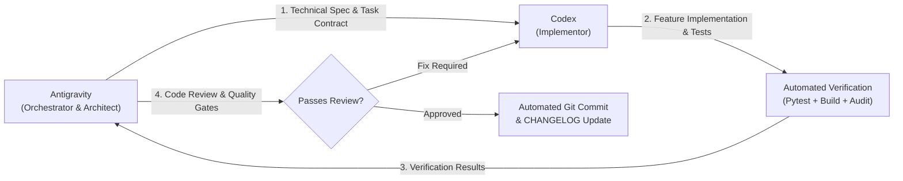

# OvaLens Master Project Plan & Execution Backlog

> **OvaLens: A YOLOv8-Based Deep Learning System for Automated Near-Real-Time Candling and Sorting of Itik Pinas Duck Eggs**  
> **Academic Institution**: College of Computer Studies, Foundation University, Dumaguete City  
> **Methodology Framework**: Design Science Research Methodology (DSRM; Peffers et al., 2007) + Agile Development Cycle (Beck et al., 2001)  
> **Engineering Roles**:  
> * **Antigravity**: Orchestrator, Lead Architect, System Design, Verification Gatekeeper, Code Review & Git Manager  
> * **Codex**: Implementor, Dedicated Feature Developer, Component Builder  

---

## 🏛️ Team Workflow & Division of Responsibilities

| Responsibility | Antigravity (Orchestrator) | Codex (Implementor) |
| :--- | :---: | :---: |
| **System Architecture & Schematics** | Lead Owner | Reviewer / Consumer |
| **Task Breakdown & Phase Tracking** | Lead Owner | - |
| **Technical Feature Implementation** | Reviewer & Verifier | Lead Owner |
| **Automated Test Execution** | Gatekeeper | Test Writer |
| **Security & Architecture Audit** | Lead Auditor | Fix Provider |
| **Git Commits & CHANGELOG.md** | Automated Operator | - |

---

## 🔄 The 5-Stage Iterative Development Cycle

For every feature or subsystem milestone, the team follows this strict 5-stage lifecycle:

1. **Stage 1: Plan & Spec (Antigravity)**
   * Select the next unblocked item from this `PROJECT_PLAN.md`.
   * Define input/output contracts (Pydantic models, TypeScript interfaces, database migrations, hardware timings).
   * Formulate the implementation prompt for Codex.

2. **Stage 2: Implementation (Codex)**
   * Implement the feature adhering strictly to [`AGENTS.md`](file:///d:/Ryle_Gabotero/side_projects/Capstone/AGENTS.md):
     - Zero Firebase dependencies.
     - Offline SQLite WAL before REST network sync.
     - 3-class biological model (`FERTILE`, `INFERTILE`, `ABNORMAL`).
     - Foundation University brand palette (`#800000`, `#357a38`, `#DC2626`).

3. **Stage 3: Automated Verification (Automated Test Suite)**
   * Run backend API suite: `pytest backend/tests/test_api.py -v`.
   * Run edge CV pipeline suite: `pytest edge/tests/test_edge_pipeline.py -v`.
   * Run dashboard typecheck and build: `npm run build` in `dashboard/`.

4. **Stage 4: Code Review & Quality Audit (Antigravity)**
   * Audit against `.agents/skills/code-reviewer/`:
     - SQL injection & input validation (Pydantic v2).
     - Idempotency (`ON CONFLICT DO NOTHING`).
     - Non-blocking multi-threading (frame grabber, ONNX inference, serial worker).
     - UI 60 FPS responsiveness and dark/light mode consistency.

5. **Stage 5: Commit & Changelog Automation (Antigravity)**
   * Execute automated commit script: `python scripts/verify_and_commit.py`.
   * Generates Conventional Commit (`feat(...)`, `fix(...)`, `refactor(...)`).
   * Updates [`CHANGELOG.md`](file:///d:/Ryle_Gabotero/side_projects/Capstone/CHANGELOG.md) and checks off item in `PROJECT_PLAN.md`.

---

## 📋 Comprehensive Capstone Phase Checklist (DSRM + Agile)

### Phase 1: Planning & Requirements (DSRM: Problem ID & Objectives)
- [x] **1.1 Research Proposal Alignment**: Establish title, problem statement, objectives, and scope in `docs/manuscript/`.
- [x] **1.2 Authentic Manuscript Integration**: Parse and format `DevIn (2026).md` into Chapters 1, 2, and References.
- [x] **1.3 Conceptual Framework (IPO)**: Import and catalog `IPO_Academic_Final.drawio` matrix.
- [x] **1.4 Research Methodology**: Import and catalog `Methodology_Updated.drawio` (7-phase DSRM + Agile).
- [x] **1.5 System Flowchart**: Import and catalog `Systemflow_chart_final.drawio` system activity diagram.
- [x] **1.6 UML Use Cases**: Import and catalog `OvaLens_Use_Case_Diagram.drawio` (Worker, Supervisor, Admin).
- [x] **1.7 Orchestrator-Implementor Architecture**: Define Antigravity + Codex collaboration standard.

### Phase 2: Data Collection & Preparation (Dataset Management)
- [ ] **2.1 Dataset Ingestion & Partitioning**: Implement automated script to split raw candling images into 70% Train, 15% Val, 15% Test.
- [ ] **2.2 Multi-Stage Stratification**: Stratify dataset by genetic line (`IP-Itim`, `IP-Khaki`, `IP-Kayumanggi`) and stage (`Day 10`, `Day 18`, `Day 25`).
- [ ] **2.3 Annotation Validator**: Script to verify whole-egg bounding box YOLO annotations (`[class_id, x_center, y_center, w, h]`).
- [ ] **2.4 Image Augmentation Pipeline**: Geometric ($\pm 15^\circ$ rotation, flips) and HSV luminance adjustments.
- [ ] **2.5 Dataset Statistics Generator**: Produce summary tables of class distribution for Chapter 3 & 4 manuscript tables.

### Phase 3: YOLOv8 Model Development & Edge Optimization
- [ ] **3.1 Ultralytics YOLOv8 Training Pipeline**: Script `edge/models/train_yolov8.py` with CIoU + BCE + DFL loss functions.
- [ ] **3.2 Model Evaluation Benchmarks**: Compute Precision, Recall, F1-Score, $\text{mAP}_{50}$, and $\text{mAP}_{50-95}$.
- [ ] **3.3 Genetic Subgroup Reporting**: Compute disaggregated metrics for IP-Itim, IP-Khaki, and IP-Kayumanggi.
- [ ] **3.4 Incubation Stage Reporting**: Compute disaggregated metrics across Day 10, Day 18, and Day 25.
- [ ] **3.5 ONNX FP16 Slim Quantization**: Script `edge/models/export_onnx.py` exporting to ONNX Runtime execution provider ($\le 200\text{ ms}$ latency target).
- [ ] **3.6 Model Latency Profiler**: Benchmark inference latency on Raspberry Pi 5 / target hardware.

### Phase 4: Hardware & Software Prototyping
#### A. Firmware & Kinematics (`firmware/`)
- [x] **4.1 ESP32 Sorter Firmware**: Implement optical sensor interrupt (GPIO 14) with 600ms lockout debounce.
- [ ] **4.2 Stepper Pocket-Conveyor Driver**: Implement indexed step timing for cradle-by-cradle transport.
- [ ] **4.3 Multi-Servo Sorting Actuation**: Actuate dedicated servo gates for Fertile, Infertile/Penoy, and Abnormal trays.
- [ ] **4.4 Serial Command Protocol**: Non-blocking UART packet parser (115200 baud) with ACK/NACK responses.

#### B. Edge CV & Desktop Controller (`edge/`)
- [x] **4.5 Multi-Threaded Engine**: Implement 4-thread architecture (Frame Grabber, ONNX Inference, Serial Worker, SQLite Sync).
- [x] **4.6 Local SQLite Store (WAL Mode)**: Atomic, immediate local scan recording before network transmission.
- [ ] **4.7 Cradle-Tracking State Machine**: Maintain egg identity and cradle index from image capture to sorting gate.
- [ ] **4.8 Fallback & Manual Review**: Detect invalid captures or low-confidence predictions ($\tau < 0.75$) and trigger operator review state.
- [ ] **4.9 Operator Desktop UI (CustomTkinter)**: 60 FPS live video stream, cradle queue visualization, session stats, and manual override modal.

#### C. Central Backend Engine (`backend/`)
- [x] **4.10 FastAPI REST API Architecture**: Pydantic v2 schemas and SQLAlchemy 2.0 ORM.
- [x] **4.11 PostgreSQL Database Models**: User, Device, Batch, Session, Scan tables.
- [x] **4.12 Idempotent Scan Ingestion**: `POST /api/v1/scans/batch` with `ON CONFLICT (scan_id) DO NOTHING`.
- [ ] **4.13 RBAC Authentication & Roles**: Implement JWT auth with Candling Worker, Hatchery Supervisor, and Admin permissions.
- [ ] **4.14 Day 10 Penoy Economic Calculator**: Auto-calculate salvage revenue ($\text{Penoy Count} \times \text{₱14.00}$).
- [ ] **4.15 Automated PDF/CSV Report Generation**: Export official batch summaries and audit logs.

#### D. Web Admin Dashboard (`dashboard/`)
- [x] **4.16 React 18 + Vite + TS Setup**: TailwindCSS styled with Foundation University brand tokens.
- [x] **4.17 Incubation Tray Matrix**: Visual representation of egg positions ($A1 \to F7$).
- [ ] **4.18 Real-Time Batch Overview**: Live stats on processed eggs, fertility rate, penoy salvage value, and discard rate.
- [ ] **4.19 Genetic Line & Stage Filters**: Filter analytics by IP-Itim/Khaki/Kayumanggi and Day 10/18/25.
- [ ] **4.20 Device & Sorter Health Monitor**: Live heartbeat and connection status for edge sorter stations.
- [ ] **4.21 User Management & Audit Trail**: Admin interface for user accounts and operational event logs.

### Phase 5: System Integration & Testing (Demonstration)
- [ ] **5.1 End-to-End Pilot Simulation**: Test complete cycle: Cradle load $\to$ Index pause $\to$ Image capture $\to$ YOLOv8 predict $\to$ Servo divert $\to$ SQLite log $\to$ HTTP sync $\to$ Dashboard display.
- [ ] **5.2 Cradle Synchronization Stress Test**: Verify egg-to-result tracking under speed variations and simulated jams.
- [ ] **5.3 Offline Network Dropout Resilience**: Disconnect backend during active sorting; verify 100% sorting continuity and subsequent bulk replay sync.
- [ ] **5.4 Operator Manual Review Testing**: Validate GUI alert and physical routing when uncertain eggs are flagged.

### Phase 6: Evaluation & Refinement (Evaluation)
- [ ] **6.1 Sorting Accuracy Benchmark**: Measure physical sorting accuracy across $\ge 100$ physical trial runs.
- [ ] **6.2 Processing Time & Throughput**: Measure end-to-end cycle time per egg and overall throughput (eggs/minute).
- [ ] **6.3 Successful-Cycle Rate**: Calculate percentage of error-free mechanical and electrical cycles.
- [ ] **6.4 Manual-Review Frequency Rate**: Measure proportion of scans routed to manual review.
- [ ] **6.5 Confusion Matrix & Metrics Consolidation**: Generate formal confusion matrix and classification metric tables for Chapter 4.

### Phase 7: Deployment & Defense Communication (Communication)
- [ ] **7.1 Manuscript Chapter 4 (Results & Discussion)**: Populate with quantitative trial data, confusion matrices, and charts.
- [ ] **7.2 Manuscript Chapter 5 (Summary & Recommendations)**: Draft conclusions, engineering insights, and future research recommendations.
- [ ] **7.3 1-Click Production Containerization**: Verify `docker-compose.yml` for PostgreSQL, FastAPI, and React dashboard.
- [ ] **7.4 Oral Defense Slide Deck & Demo Script**: Prepare interactive presentation and live hardware demonstration runbook.

---

## 📈 Living Changelog & Release Milestones

All feature implementations, fixes, and architectural updates are tracked in [`CHANGELOG.md`](file:///d:/Ryle_Gabotero/side_projects/Capstone/CHANGELOG.md).

