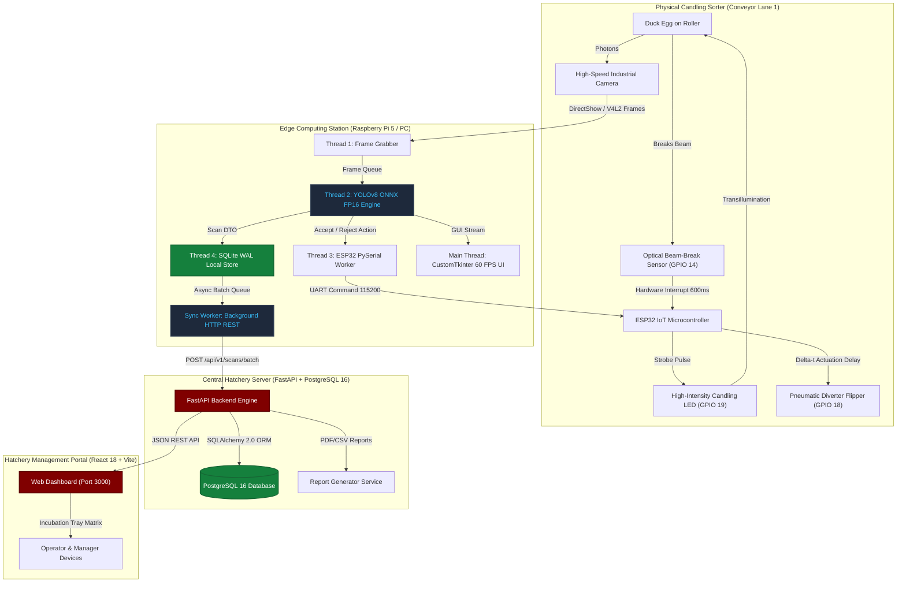
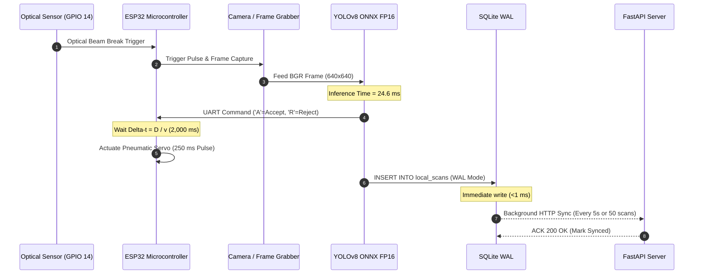

# OvaLens System Diagrams & Architectural Schematics

This directory contains architectural blueprints, hardware wiring schematics, operational flowcharts, and database Entity-Relationship Diagrams (ERDs) for the **OvaLens** Capstone manuscript and defense presentation.

---

## 📁 Diagram Subdirectories

* [`architecture/`](file:///d:/Ryle_Gabotero/side_projects/Capstone/docs/diagrams/architecture): High-level monorepo topology, Input-Process-Output (IPO) framework, and DSRM research methodology.
* [`flowcharts/`](file:///d:/Ryle_Gabotero/side_projects/Capstone/docs/diagrams/flowcharts): System activity flowchart, candling inference flow, and diverter kinematics state machines.
* [`hardware_schematics/`](file:///d:/Ryle_Gabotero/side_projects/Capstone/docs/diagrams/hardware_schematics): ESP32 pinouts, relay connections, power rails, and optical beam-break sensor debouncing.
* [`database_erds/`](file:///d:/Ryle_Gabotero/side_projects/Capstone/docs/diagrams/database_erds): PostgreSQL 16 relational database schema and SQLite WAL edge data models.
* [`use_cases/`](file:///d:/Ryle_Gabotero/side_projects/Capstone/docs/diagrams/use_cases): UML Use Case diagrams, actor permissions, and operational scopes.

### 📊 Master Diagram Matrix

| Subsystem / Purpose | Editable Model (`.drawio`) | Interactive Browser View (`.html`) | Category |
| :--- | :--- | :--- | :--- |
| **Input-Process-Output (IPO) Matrix** | [`IPO_Academic_Final.drawio`](file:///d:/Ryle_Gabotero/side_projects/Capstone/docs/diagrams/architecture/IPO_Academic_Final.drawio) | [`IPO_Academic_Final.drawio.html`](file:///d:/Ryle_Gabotero/side_projects/Capstone/docs/diagrams/architecture/IPO_Academic_Final.drawio.html) | Conceptual Framework |
| **Research Methodology (DSRM + Agile)** | [`Methodology_Updated.drawio`](file:///d:/Ryle_Gabotero/side_projects/Capstone/docs/diagrams/architecture/Methodology_Updated.drawio) | [`Methodology_Updated.drawio.html`](file:///d:/Ryle_Gabotero/side_projects/Capstone/docs/diagrams/architecture/Methodology_Updated.drawio.html) | Methodology Architecture |
| **System Activity & Candling Flowchart** | [`Systemflow_chart_final.drawio`](file:///d:/Ryle_Gabotero/side_projects/Capstone/docs/diagrams/flowcharts/Systemflow_chart_final.drawio) | [`Systemflow_chart_final.drawio.html`](file:///d:/Ryle_Gabotero/side_projects/Capstone/docs/diagrams/flowcharts/Systemflow_chart_final.drawio.html) | Operational Logic |
| **Master UML Use Case Diagram** | [`OvaLens_Use_Case_Diagram.drawio`](file:///d:/Ryle_Gabotero/side_projects/Capstone/docs/diagrams/use_cases/OvaLens_Use_Case_Diagram.drawio) | [`OvaLens_Use_Case_Diagram.drawio.html`](file:///d:/Ryle_Gabotero/side_projects/Capstone/docs/diagrams/use_cases/OvaLens_Use_Case_Diagram.drawio.html) | Role & Permissions |

---

## 🏛️ 1. High-Level System Architecture Diagram

---

## ⚙️ 2. Edge Multi-Threading & Synchronization Flowchart

