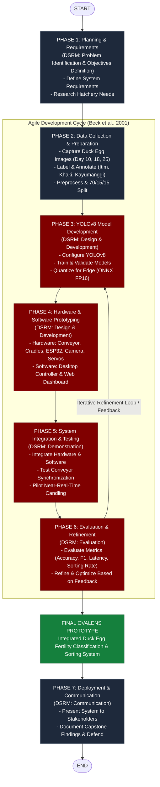

# System Architecture & Conceptual Framework Diagrams

This directory contains high-resolution architectural schematics, research frameworks, and conceptual models for **OvaLens**.

---

## 📄 Diagram Assets

| Diagram | Formats | Purpose |
| :--- | :--- | :--- |
| **Input-Process-Output (IPO) Framework** | [`.drawio`](file:///d:/Ryle_Gabotero/side_projects/Capstone/docs/diagrams/architecture/IPO_Academic_Final.drawio) \| [`.html`](file:///d:/Ryle_Gabotero/side_projects/Capstone/docs/diagrams/architecture/IPO_Academic_Final.drawio.html) | Academic conceptual matrix defining inputs, processing stages, and outputs for the capstone manuscript |
| **Research Methodology (DSRM + Agile)** | [`.drawio`](file:///d:/Ryle_Gabotero/side_projects/Capstone/docs/diagrams/architecture/Methodology_Updated.drawio) \| [`.html`](file:///d:/Ryle_Gabotero/side_projects/Capstone/docs/diagrams/architecture/Methodology_Updated.drawio.html) | 7-Phase Design Science Research Methodology (Peffers et al., 2007) with Agile development feedback loops |

---

## 🏛️ 1. Input-Process-Output (IPO) Matrix

```mermaid
flowchart LR
    subgraph INPUT["INPUT"]
        I1["1. Problem & Requirements\n- Manual Candling Issues\n- Hatchery Operational Needs"]
        I2["2. Duck Egg Dataset\n- 3,000+ Annotated Images\n- Breeds: Itim, Khaki, Kayumanggi\n- Stages: Day 10, 18, 25"]
        I3["3. Technical Resources\n- YOLOv8 & Raspberry Pi\n- Camera, LED, Cradles\n- Stepper & Servo Motors"]
        I4["4. Theoretical Design Basis\n- Related Literature\n- Vibration-Conscious Handling"]
    end

    subgraph PROCESS["PROCESS"]
        P1["1. Data Preparation\n- Image Capture & Annotation\n- 70/15/15 Dataset Split"]
        P2["2. Model Development\n- YOLOv8 Configuration\n- Training & Validation\n- Hyperparameter Tuning"]
        P3["3. System Prototyping\n- Hardware Assembly\n- Software App Coding\n- Dashboard Development"]
        P4["4. Integration & Testing\n- Sorting/Inference Syncing\n- Evaluate Metrics (F1, Speed)\n- Assess Overall Reliability"]
        P5["5. System Intervention\n- Manual Flagging & Review Protocol"]
    end

    subgraph OUTPUT["OUTPUT"]
        O1["1. OvaLens Hardware Setup\n- Stepper-Driven Conveyor\n- Fixed Candling Chamber\n- Servo Sorting Mechanism"]
        O2["2. OvaLens Software System\n- Raspberry Pi Control App\n- Web-Based Admin Dashboard"]
        O3["3. Trained AI Model\n- Optimized YOLOv8 Architecture\n- Classifies: Fertile, Infertile, Abnormal"]
        O4["4. Empirical Results\n- Performance Documentation"]
        O5["5. Physical Candling Chamber"]
    end

    INPUT --> PROCESS --> OUTPUT

    classDef inout fill:#1E293B,stroke:#475569,color:#F8FAFC;
    classDef proc fill:#800000,stroke:#5C0000,color:#fff;
    class I1,I2,I3,I4,O1,O2,O3,O4,O5 inout;
    class P1,P2,P3,P4,P5 proc;
```

---

## 🔬 2. Research Methodology Framework (DSRM + Agile)

