# Operational & Logic Flowcharts

This directory contains the operational and logic flowcharts for the **OvaLens** automated candling and sorting ecosystem.

## 📄 Diagram Assets

* **Master Activity Flowchart (Editable)**: [`Systemflow_chart_final.drawio`](file:///d:/Ryle_Gabotero/side_projects/Capstone/docs/diagrams/flowcharts/Systemflow_chart_final.drawio)
* **Interactive HTML Viewer**: [`Systemflow_chart_final.drawio.html`](file:///d:/Ryle_Gabotero/side_projects/Capstone/docs/diagrams/flowcharts/Systemflow_chart_final.drawio.html)
* **Fertility Classification Pipeline Vector**: [`Flowchart-5 - Fertility Classification Pipeline.drawio.svg`](file:///d:/Ryle_Gabotero/side_projects/Capstone/docs/diagrams/flowcharts/Flowchart-5%20-%20%20Fertility%20Classification%20Pipeline.drawio.svg)

---

## 🔄 OvaLens System Activity & Sorting Workflow

```mermaid
flowchart TD
    START([START]) --> InitApp["Open OvaLens Desktop Controller"]
    InitApp --> ConfigBatch["Set Batch, Candling Stage, & Itik Pinas Line\n(IP-Itim, IP-Khaki, IP-Kayumanggi | Day 10, 18, 25)"]
    ConfigBatch --> InitSys["Initialize Hardware & Communications"]
    
    InitSys --> SysReady{System Ready?}
    SysReady -- "No" --> DispFault["Display System Fault Alert"]
    DispFault --> ReInit{Re-initialize System?}
    ReInit -- "Yes" --> InitSys
    ReInit -- "No" --> END_FAULT([END])
    
    SysReady -- "Yes" --> LoadEgg["Load Egg into Available Cradle\n& Start Candling Session"]
    LoadEgg --> AssignID["Assign Cradle ID to Egg Record"]
    AssignID --> IndexCandle["Index Cradle to Candling Position"]
    IndexCandle --> Capture["Illuminate LED & Capture Candling Frame"]
    Capture --> DetectYOLO["Detect Egg & Predict Class using YOLOv8"]
    
    DetectYOLO --> CheckValid{Valid Classification?}
    CheckValid -- "No (Low Conf / Invalid)" --> FlagReview["Flag for Manual Review"]
    FlagReview --> Override["Operator Overrides or Confirms Result"]
    Override --> AssocCradle
    
    CheckValid -- "Yes" --> AssocCradle["Associate Class & Confidence with Cradle ID"]
    AssocCradle --> LocalSave["Save Classification Record Locally\n(SQLite WAL Mode)"]
    LocalSave -.-> BackgroundSync["Background Sync Worker\n(Local -> FastAPI -> PostgreSQL -> Web Dashboard)"]
    
    LocalSave --> IndexTrack["Index Conveyor & Track Cradle Position"]
    IndexTrack --> CheckSync{Cradle Tracking\nSynchronized?}
    CheckSync -- "No" --> PauseResync["Pause Conveyor & Resynchronize Cradles"]
    PauseResync --> CheckSync
    
    CheckSync -- "Yes" --> SegStation["Cradle Reaches Assigned Segregation Gate"]
    
    SegStation --> CheckEmpty{Cradle Empty?}
    CheckEmpty -- "Yes" --> CheckCont
    
    CheckEmpty -- "No" --> ClassifyChoice{Fertile?}
    ClassifyChoice -- "Yes" --> TrayFertile["Release to Fertile Incubation Tray"]
    ClassifyChoice -- "Infertile" --> TrayInfertile["Divert to Infertile Tray\n(Day 10 Penoy Salvage @ ₱14)"]
    
    TrayFertile --> RecordOutcome["Record Segregation Outcome\n& Update Session Statistics"]
    TrayInfertile --> RecordOutcome
    
    RecordOutcome --> CheckCont{Continue Session?}
    CheckCont -- "Yes (More Eggs)" --> LoadEgg
    CheckCont -- "No" --> Finalize["Finalize Candling Session\nGenerate Batch Summary"]
    Finalize --> END([END])

    classDef startend fill:#334155,stroke:#0F172A,color:#fff;
    classDef action fill:#1E293B,stroke:#475569,color:#F8FAFC;
    classDef decision fill:#800000,stroke:#5C0000,color:#fff;
    classDef success fill:#15803D,stroke:#166534,color:#fff;
    classDef reject fill:#DC2626,stroke:#991B1B,color:#fff;

    class START,END,END_FAULT startend;
    class InitApp,ConfigBatch,InitSys,LoadEgg,AssignID,IndexCandle,Capture,DetectYOLO,AssocCradle,LocalSave,IndexTrack,PauseResync,SegStation,RecordOutcome,Finalize,Override action;
    class SysReady,ReInit,CheckValid,CheckSync,CheckEmpty,ClassifyChoice,CheckCont decision;
    class TrayFertile,BackgroundSync success;
    class TrayInfertile,DispFault,FlagReview reject;
```

