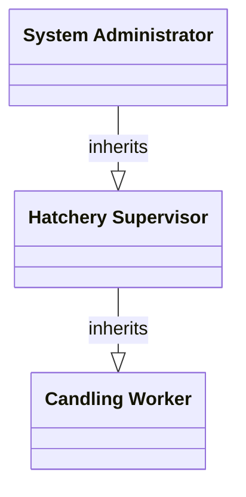

# Use Case Diagrams & Operational Scopes

This directory contains the master UML Use Case diagram and actor role hierarchy for the **OvaLens** Hatchery Management System.

## 📄 Diagram Assets

* **Draw.io Model (Editable)**: [`OvaLens_Use_Case_Diagram.drawio`](file:///d:/Ryle_Gabotero/side_projects/Capstone/docs/diagrams/use_cases/OvaLens_Use_Case_Diagram.drawio)
* **Interactive HTML Viewer**: [`OvaLens_Use_Case_Diagram.drawio.html`](file:///d:/Ryle_Gabotero/side_projects/Capstone/docs/diagrams/use_cases/OvaLens_Use_Case_Diagram.drawio.html)

---

## 👥 Actor Hierarchy & Functional Scopes

### 1. Candling Worker (Edge Candling Operations)
* **Log In / Authenticate User**
* **Manage Candling Session** (Start, Pause, Terminate indexed sorting)
* **Monitor Live Video Feed** (Direct camera frame grabber stream)
* **View Session Statistics** (Real-time count of fertile, infertile, abnormal, processed eggs)
* **Review Flagged Classifications** (Inspect low-confidence captures, manual override)

### 2. Hatchery Supervisor (Hatchery Management & Analytics)
* *Inherits all Candling Worker permissions, plus:*
* **View Classification Analytics** (Mortality rates, fertility percentage trends)
* **Generate Reports** (Export automated PDF / CSV summary reports)
* **View Hatchery Overview** (Aggregated multi-batch statistics)
* **Manage Batches** (Create, edit, close incubation batches)
* **Review Candling Records** (Historical scan inspection)
* **Monitor Device Status** (Edge sorter heartbeat, hardware connection status)

### 3. System Administrator (Full System Administration)
* *Inherits all Hatchery Supervisor permissions, plus:*
* **Manage User Accounts** (RBAC user provisioning and permissions)
* **View Audit Logs** (System event trails, login activities, override actions)
* **Configure System Settings** (Database connection, network sync intervals, thresholds)
* **Manage Model Deployment Settings** (YOLOv8 weights, confidence thresholds, ONNX FP16 runtime parameters)
